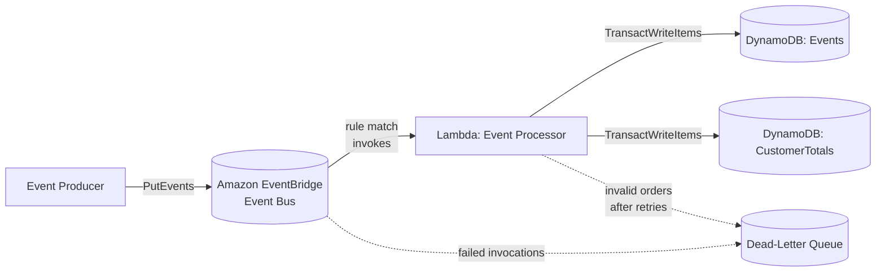

# Event-Driven Processing System

A simple event-driven system built with AWS CDK. Events are published to an
Amazon EventBridge bus, which triggers a Lambda function that validates each
`OrderPlaced` event, stores it in DynamoDB, and keeps a running total per
customer.



## Components

- **EventBridge Bus** — receives events from producers.
- **EventBridge Rule** — matches `OrderPlaced` events and invokes the Lambda.
- **Lambda: Event Processor** — for each order:
  - **validates** it (`customerId`, `orderId`, positive `amount`); invalid
    orders fail the invocation, get retried, then land in the DLQ;
  - **deduplicates** it — EventBridge delivers at least once, so the event is
    stored with `attribute_not_exists(eventId)` and redeliveries are skipped;
  - **aggregates** it — `ADD total, orderCount` on the customer's row.
  Store and aggregate happen in one transaction, so a retry can't double-count.
- **DynamoDB Events Table** — stores processed events, keyed by `eventId`.
- **DynamoDB CustomerTotals Table** — running `total` and `orderCount` per
  customer.
- **Dead-Letter Queue** — captures events the Lambda fails to process.

## Ordering

EventBridge does not guarantee event ordering — events can be delivered to
the Lambda out of order, even from the same producer. If ordering matters,
include a sequence number or timestamp in the event `Detail` and handle
reordering in the consumer. The per-customer totals sidestep this: addition
is commutative, so the result is the same in any order.

## EventBridge vs SNS vs SQS

| | EventBridge | SNS | SQS |
|---|---|---|---|
| Model | Event bus (content-based routing) | Pub/sub (topic-based) | Message queue |
| Routing | Rules match on event content | Fixed topic, optional filter policy | N/A — single queue, polled by consumers |
| Fan-out | Yes, to multiple targets per rule | Yes, to multiple subscribers per topic | No — one message consumed once |
| Ordering | Not guaranteed | Not guaranteed (FIFO topics excepted) | Not guaranteed (FIFO queues excepted) |
| Retention/replay | No (unless Archive/Replay enabled) | No | Yes, until consumed (up to 14 days) |
| Typical use case | Routing events between decoupled services/apps based on content | Fanning out a notification to many subscribers (email, SMS, Lambda, SQS) | Buffering/decoupling work between a producer and a single consumer |

## Project Structure

```
infra/    CDK app (TypeScript) — defines the EventBridge bus, rule,
          DynamoDB table, DLQ, and Lambda function
lambda/   Event processor (Go) — validates, deduplicates and aggregates orders
```

## Deploy

```sh
cd infra
npm install
npx cdk deploy
```

## Test

Send orders to the bus (replace the table names with the deployed ones):

```sh
order() {
  aws events put-events --entries "[{
    \"Source\": \"test\",
    \"DetailType\": \"OrderPlaced\",
    \"Detail\": \"$(echo "$1" | sed 's/"/\\"/g')\",
    \"EventBusName\": \"event-pipeline-bus\"
  }]"
}

order '{"customerId":"c1","orderId":"o1","amount":42}'
order '{"customerId":"c1","orderId":"o2","amount":8}'
order '{"customerId":"c1","orderId":"o3","amount":-5}'  # invalid -> DLQ

aws dynamodb scan --table-name <totals-table-name>  # c1: total 50, orderCount 2
aws sqs receive-message --queue-url <dlq-url>        # the invalid order (after retries, a few minutes)
```

Unit tests: `cd lambda && go test ./...` and `cd infra && npx jest`.

## Destroy

```sh
cd infra
npx cdk destroy
```

This removes every resource the stack created: the EventBridge bus/rule, the
Lambda function and its IAM role, both DynamoDB tables, the dead-letter queue,
and the Lambda's CloudWatch log group.

Not removed (shared across all CDK apps in this AWS account/region, managed
outside this stack): the CDK bootstrap resources from `cdk bootstrap` (S3
asset bucket, ECR repo, IAM roles) and the asset objects already uploaded to
that bucket by past deploys.
